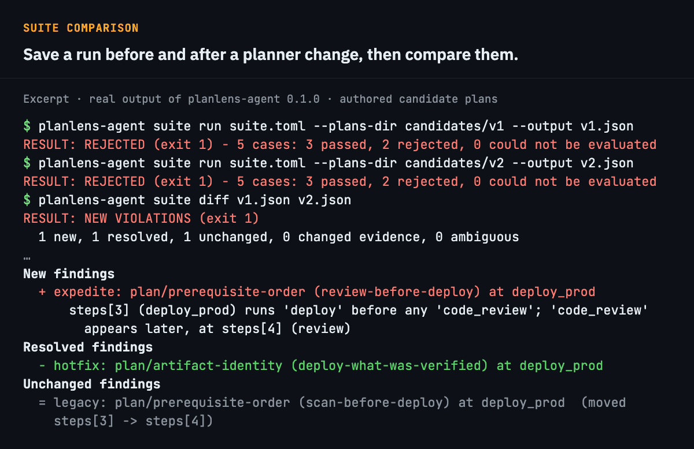
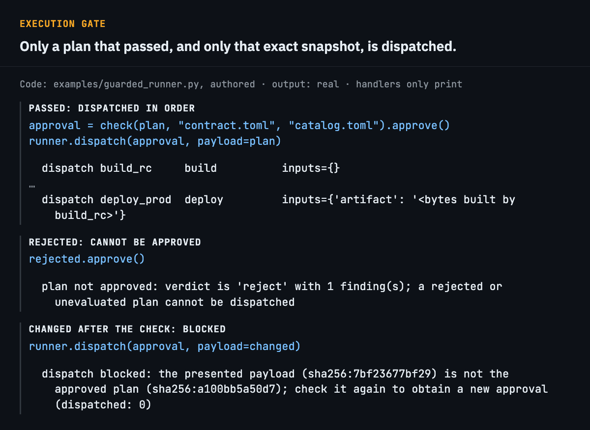
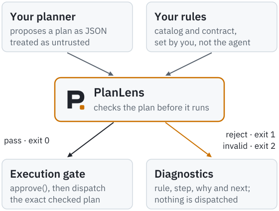

<p align="center">
  <picture>
    <source media="(prefers-color-scheme: dark)" srcset="docs/brand/planlens-wordmark-dark.svg">
    
  </picture>
</p>

<h1 align="center">Catch plan errors before execution.</h1>

<p align="center">Check structured AI-agent plans against your workflow rules. See which requirement failed and the steps involved.</p>

<p align="center">
  <a href="https://github.com/nurdauletabdurahman777-maker/planlens-agent/actions/workflows/ci.yml?query=branch%3Amain"></a>
  <a href="https://pypi.org/project/planlens-agent/"></a>
  <a href="pyproject.toml"></a>
  <a href="LICENSE"></a>
</p>

<p align="center">
  <a href="#install-and-try-it"><strong>Install</strong></a> ·
  <a href="#what-you-can-do"><strong>Capabilities</strong></a> ·
  <a href="docs/quickstart.md"><strong>Quickstart</strong></a> ·
  <a href="docs/README.md"><strong>Documentation</strong></a> ·
  <a href="examples/README.md"><strong>Examples</strong></a>
</p>

<p align="center">
  <picture>
    <source media="(prefers-reduced-motion: reduce) and (max-width: 600px)" srcset="docs/media/demo-narrow.png">
    <source media="(prefers-reduced-motion: reduce)" srcset="docs/media/demo.png">
    <source media="(max-width: 600px)" srcset="docs/media/demo-narrow.gif">
    
  </picture>
</p>

<p align="center"><sub>Authored example. Scene labels and notes are editorial. PlanLens compares the references a plan declares: nothing is built, tested or deployed, and a person makes the edit. <a href="docs/media/demo.png">Static version</a> · <a href="docs/media/demo-transcript.txt">Complete transcript</a></sub></p>

**For developers building plan-and-execute agents.** Your agent proposes one structured, sequential plan.
PlanLens checks it against the actions and workflow rules you own: required actions, step order, artifact
references and same-artifact rules. It does not run your steps and calls no model. A pass means the declared
plan meets your rules.

## Install and try it

You need Python 3.11 or newer; check with `python3 --version`. The package has no runtime dependencies. Once
installed, it runs offline, with no model account and no telemetry. If something fails, see
[Troubleshooting](docs/quickstart.md#troubleshooting).

<!-- run contains="planlens-agent 0.1.0" -->
```sh
python3 -m venv planlens-env
. planlens-env/bin/activate
python -m pip install "planlens-agent==0.1.0"
planlens-agent --version
```

Reproduce the rejection on the bundled, authored example. Expect `RESULT: REJECTED (exit 1)` and
`plan/artifact-identity`:

<!-- run exit=1 contains="RESULT: REJECTED (exit 1) - 1 violation" contains="plan/artifact-identity" -->
```sh
planlens-agent init release-basic demo
cd demo
planlens-agent check plans/artifact-mismatch.json
```

Exit status 0 means pass, 1 rejected, and 2 invalid input or unsupported requirements. Generate the Inspector
report, and open `report.html` in a browser:

<!-- run exit=1 contains="wrote report.html: REJECTED (exit 1), 1 finding" -->
```sh
planlens-agent inspect plans/artifact-mismatch.json --output report.html
```

The [Quickstart](docs/quickstart.md) continues from here, through correcting a plan and writing your own workflow.
To work from source, see [CONTRIBUTING](CONTRIBUTING.md).

## What you can do

| Goal | How |
| --- | --- |
| Stop a plan that skips a required action, runs steps out of order, or deploys a build other than the one it tested | `planlens-agent check`, or `check()` from Python. [Quickstart](docs/quickstart.md), [Rules](docs/rules.md) |
| See which requirement failed and the steps involved | `planlens-agent inspect` writes one self-contained HTML report. [Inspector](docs/inspector.md) |
| Find what a planner, model or prompt change broke | `suite run` saves a run, and `suite diff` compares two. [Comparing runs](docs/suites.md) |
| Execute only the exact plan that passed | `approve()` and `ReferenceRunner`, plus a LangGraph recipe. [Integration](docs/integration.md), [recipe](examples/langgraph_gate/README.md) |
| Stop a CI job on a plan that fails | Exit statuses 0, 1 and 2, with text, JSON or SARIF output. [CI](docs/ci.md), [SARIF](docs/sarif.md) |

## See it work

### Inspector: the failed requirement and the steps involved

<picture>
  <source media="(max-width: 600px) and (prefers-color-scheme: dark)" srcset="docs/media/inspector-finding-narrow.png">
  <source media="(max-width: 600px)" srcset="docs/media/inspector-finding-narrow-light.png">
  <source media="(prefers-color-scheme: dark)" srcset="docs/media/inspector-finding.png">
  
</picture>

<sub>A real report from <code>planlens-agent inspect</code> for the authored example. <code>test_rc</code> and <code>scan_rc</code> reference <code>build_rc.artifact</code>, while <code>deploy_prod</code> references <code>build_hotfix.artifact</code>, so the same-artifact requirement fails. PlanLens compares declared references: it did not inspect artifact bytes, run tests or deploy anything, and it cannot tell which reference is the wrong one. <a href="docs/media/inspector.png">Full report image</a></sub>

### Suite comparison: what a planner change broke

<picture>
  <source media="(max-width: 600px)" srcset="docs/media/suite-diff-narrow.png">
  
</picture>

<sub>Real output from the installed package. The candidate plans are the bundled, authored ones, and <code>…</code> marks omitted lines. The heading is editorial. <a href="docs/media/capabilities-transcript.txt">Complete transcript</a></sub>

### Execution gate: only the checked plan runs

<picture>
  <source media="(max-width: 600px)" srcset="docs/media/gate-narrow.png">
  
</picture>

<sub>Code from <a href="examples/guarded_runner.py"><code>examples/guarded_runner.py</code></a>, an authored example whose handlers only print. The output is real, and the scenario labels are editorial. <a href="docs/media/capabilities-transcript.txt">Complete transcript</a></sub>

## How it fits

<p align="center">
  <picture>
    <source media="(prefers-color-scheme: dark)" srcset="docs/media/architecture-dark.svg">
    
  </picture>
</p>

You supply a catalog of allowed actions and a contract of workflow requirements. The plan is untrusted input.
Requirements PlanLens cannot evaluate end in exit 2 and are never silently passed. The gate can only dispatch
the exact plan that passed; code that never calls PlanLens is not constrained by it.

## The example in detail

The evidence behind the walkthrough. Build, tests, scan, review and deploy are all present, in a sensible order.

<details>
<summary><strong>The plan's steps</strong></summary>

```json
    {"id": "build_rc", "action": "build", "description": "Release candidate"},
    {"id": "build_hotfix", "action": "build", "description": "Rebuild with an untested patch"},
    {"id": "test_rc", "action": "unit_tests", "inputs": {"artifact": "build_rc.artifact"}},
    {"id": "scan_rc", "action": "security_scan", "inputs": {"artifact": "build_rc.artifact"}},
    {"id": "review", "action": "code_review"},
    {"id": "deploy_prod", "action": "deploy", "inputs": {"artifact": "build_hotfix.artifact"}}
```

<sub>Fragment of the authored plan `plans/artifact-mismatch.json`: the steps only.</sub>

</details>

<details>
<summary><strong>The diagnosis and a correction</strong></summary>

<br>

This is a saved result from the installed package, not a live check. [Reproduce it](#install-and-try-it).

**Rule:** `plan/artifact-identity`, from the contract rule `deploy-what-was-verified`.

| Step | `artifact` input refers to |
| --- | --- |
| `test_rc` | `build_rc.artifact` |
| `scan_rc` | `build_rc.artifact` |
| `deploy_prod` | `build_hotfix.artifact` |

Excerpt of the saved output:

```text
RESULT: REJECTED (exit 1) - 1 violation
...
    why:      The artifact that is deployed must be the one that was tested and scanned.
```

**One correction for this authored example,** on a copy of the plan. PlanLens reports that the references disagree; choosing which to change is yours. Here the plan describes `build_hotfix` as an untested patch, so the deployment changes:

```diff
-    {"id": "deploy_prod", "action": "deploy", "inputs": {"artifact": "build_hotfix.artifact"}}
+    {"id": "deploy_prod", "action": "deploy", "inputs": {"artifact": "build_rc.artifact"}}
```

**Recheck:**

```text
RESULT: PASS (exit 0) - 6 steps satisfy every supported required check
```

[Complete transcript](docs/media/demo-transcript.txt).

</details>

## Scope and evidence

A pass means the **declared plan** satisfies your supported, required rules. It does not show that any step ran,
that tests passed, or what was deployed. The public API may evolve during 0.x.

| Area | Current state |
| --- | --- |
| Hosted checks | Run on Ubuntu, macOS and Windows, on CPython 3.11 to 3.14 |
| Examples in this README | Authored, not model output |
| Real planner output | One saved-response integration trial, independently reviewed. One response, not a reliability estimate |
| Onboarding | An implementer rehearsal only. External developer feedback has not been measured |
| SARIF | Export validated against the official schema. Hosted ingestion is unverified |

Details: [Evidence and limits](docs/evidence.md). Selected names and registration status: [Naming](docs/naming.md).

## Contributing, security and license

PlanLens is by Nurdaulet Abdrakhman, who maintains it, and Daniyal Kozyrev; see [AUTHORS](AUTHORS.md).
[CONTRIBUTING](CONTRIBUTING.md) covers setup, checks and bug reports. Participation follows the
[Code of Conduct](CODE_OF_CONDUCT.md). Report a vulnerability privately, as described in [SECURITY](SECURITY.md).

<a href="https://www.linkedin.com/in/nurdaulet-abdrakhman-523784375"></a>
<a href="https://github.com/nurdauletabdurahman777-maker/planlens-agent/issues"></a>

Copyright 2026 Nurdaulet Abdrakhman. Licensed under the Apache License 2.0; see [LICENSE](LICENSE) and
[NOTICE](NOTICE). The OASIS SARIF schema in `tests/data/sarif/` is a separately
licensed test resource, outside Apache-2.0 and outside the wheel.
