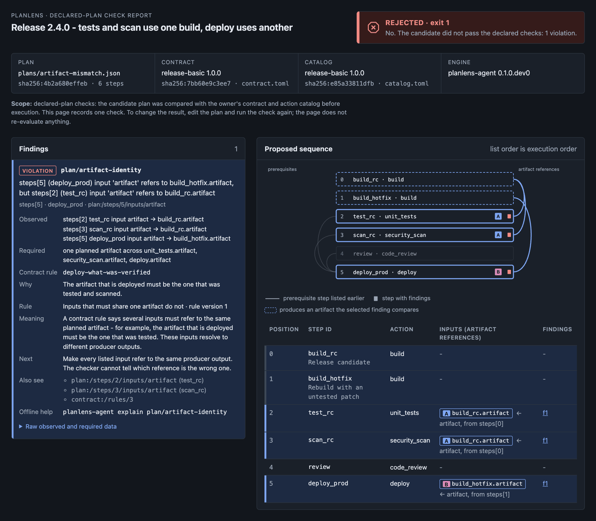

<p align="center">
  <picture>
    <source media="(prefers-color-scheme: dark)" srcset="docs/brand/planlens-wordmark-dark.svg">
    
  </picture>
</p>

<p align="center"><strong>Lint AI-agent plans before they run.</strong></p>

<p align="center">
  <a href="#install">Install</a> ·
  <a href="docs/quickstart.md">Quickstart</a> ·
  <a href="docs/README.md">Documentation</a> ·
  <a href="examples/README.md">Examples</a>
</p>

<p align="center"><sub>Private pre-release · Python 3.11+ · Apache-2.0 · No runtime dependencies</sub></p>

PlanLens checks a structured plan from an AI agent against rules you own, and reports exactly what is
wrong before any step runs. It is for developers building plan-and-execute agents.

It catches steps in the wrong order, missing required actions, references to artifacts no earlier step
produces, and a deployment of a different build from the one that was tested.

| You supply | Your agent proposes | PlanLens returns |
| --- | --- | --- |
| Trusted actions (a catalog) and workflow requirements (a contract) | A structured, sequential plan | A deterministic verdict, specific diagnostics and an optional execution gate |


<sub>Authored example, excerpted from real installed-wheel output. Nothing was deployed. [Static image](docs/media/demo.png) · [Complete transcript](docs/media/demo-transcript.txt)</sub>

## Install

You need Python 3.11 or newer (check `python3 --version`), Git, and read access to this private
[repository](https://github.com/nurdauletabdurahman777-maker/planlens-agent). PlanLens is not on PyPI.
Building the wheel downloads its pinned build backend once. After that, it runs offline, with no model
account and no telemetry. If something fails, see [Troubleshooting](docs/quickstart.md#troubleshooting).

<!-- run prereq -->
```sh
git clone --branch launch/developer-experience \
  https://github.com/nurdauletabdurahman777-maker/planlens-agent.git
python3 -m venv build-env
build-env/bin/python -m pip wheel --no-deps --wheel-dir wheelhouse ./planlens-agent
```

<!-- run contains="planlens-agent 0.1.0.dev0" -->
```sh
python3 -m venv planlens-env
. planlens-env/bin/activate
pip install --no-index wheelhouse/planlens_agent-0.1.0.dev0-py3-none-any.whl
planlens-agent --version
```

Try it on a bundled, authored example:

<!-- run exit=1 contains="RESULT: REJECTED (exit 1) - 1 violation" contains="plan/artifact-identity" -->
```sh
planlens-agent init release-basic demo
cd demo
planlens-agent check plans/artifact-mismatch.json
```

Exit status 0 means pass, 1 rejected, and 2 invalid input or unsupported requirements. The
[Quickstart](docs/quickstart.md) continues from here, through correcting a plan and writing your own workflow.

## All required steps are present. Would you deploy this?

Build, tests, scan, review and deploy are all here, in a sensible order.

```json
    {"id": "build_rc", "action": "build", "description": "Release candidate"},
    {"id": "build_hotfix", "action": "build", "description": "Rebuild with an untested patch"},
    {"id": "test_rc", "action": "unit_tests", "inputs": {"artifact": "build_rc.artifact"}},
    {"id": "scan_rc", "action": "security_scan", "inputs": {"artifact": "build_rc.artifact"}},
    {"id": "review", "action": "code_review"},
    {"id": "deploy_prod", "action": "deploy", "inputs": {"artifact": "build_hotfix.artifact"}}
```

<sub>Fragment of the authored plan `plans/artifact-mismatch.json`: the steps only.</sub>

<details>
<summary><strong>Reveal the PlanLens diagnosis</strong></summary>

<br>

This is a saved result from the installed package, not a live check. Run the command above to reproduce it.

**Rule:** `plan/artifact-identity`, from the contract rule `deploy-what-was-verified`.

| Step | `artifact` input refers to |
| --- | --- |
| `test_rc` | `build_rc.artifact` |
| `scan_rc` | `build_rc.artifact` |
| `deploy_prod` | `build_hotfix.artifact` |

Excerpt of the saved output:

```text
RESULT: REJECTED (exit 1) - 1 violation
...
    why:      The artifact that is deployed must be the one that was tested and scanned.
```

**Correction,** on a copy of the plan:

```diff
-    {"id": "deploy_prod", "action": "deploy", "inputs": {"artifact": "build_hotfix.artifact"}}
+    {"id": "deploy_prod", "action": "deploy", "inputs": {"artifact": "build_rc.artifact"}}
```

**Recheck:**

```text
RESULT: PASS (exit 0) - 6 steps satisfy every supported required check
```

This checks the plan. Nothing was deployed. [Complete transcript](docs/media/demo-transcript.txt).

</details>

## How it works

1. **You** supply a catalog of allowed actions and a contract of workflow requirements. The agent cannot change either.
2. **Your agent** proposes an ordered plan as JSON. PlanLens treats it as untrusted.
3. **PlanLens** checks the plan before anything runs and returns a verdict with specific diagnostics. Requirements it cannot evaluate end in exit 2 and are never silently passed.

| Path | What it does | Guide |
| --- | --- | --- |
| CLI | `planlens-agent check`: text, JSON or SARIF, with exit statuses for scripts | [Quickstart](docs/quickstart.md) |
| Python SDK | `check()` returns the same verdict and diagnostics | [Integration](docs/integration.md) |
| Inspector | `planlens-agent inspect`: one self-contained HTML report | [Inspector](docs/inspector.md) |
| Comparison | `suite run` and `suite diff`: what changed after a planner, model or prompt change | [Comparing runs](docs/suites.md) |
| Execution gate | `approve()` and `ReferenceRunner` dispatch only the exact plan that passed | [Integration](docs/integration.md), [LangGraph recipe](examples/langgraph_gate/README.md) |
| CI | Workflows, exit statuses and reviewed baselines | [CI](docs/ci.md) |

The inspector shows one check as a report, with the finding and the steps it involves. From `demo/`:

<!-- run exit=1 contains="wrote report.html: REJECTED (exit 1), 1 finding" -->
```sh
planlens-agent inspect plans/artifact-mismatch.json --output report.html
```

<picture>
  <source media="(prefers-color-scheme: light)" srcset="docs/media/inspector-light.png">
  
</picture>

## What a pass means

A pass means the **declared plan** satisfies your supported, required rules. It does not show that any step
ran, that tests passed, or what was deployed. PlanLens is a library and a command: code that never calls it
is not constrained by it.

## Status

| Area | Current state |
| --- | --- |
| Hosted checks | Run on Ubuntu, macOS and Windows, on CPython 3.11 to 3.14 |
| Examples in this README | Authored, not model output |
| Real planner output | One saved-response integration trial, independently reviewed. One response, not a reliability estimate |
| Onboarding | An implementer rehearsal only. External developer feedback has not been measured |
| SARIF | Export validated against the official schema. Hosted ingestion is unverified |

Details: [Evidence and limits](docs/evidence.md). Names are provisional: [Naming](docs/naming.md).

## Contributing and license

See [CONTRIBUTING](CONTRIBUTING.md) for setup, checks and bug reports.

Licensed under the Apache License 2.0; see [LICENSE](LICENSE) and [NOTICE](NOTICE). Authorship and copyright
holders are pending; see [AUTHORS](AUTHORS.md). The OASIS SARIF schema in `tests/data/sarif/` is a separately
licensed test resource, outside Apache-2.0 and outside the wheel.
